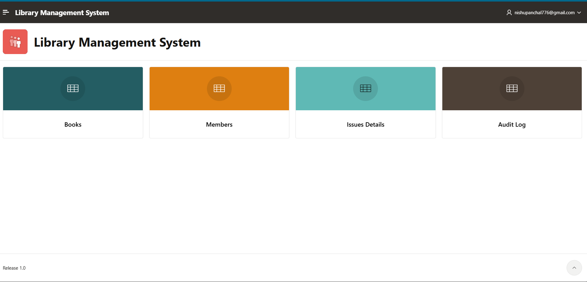
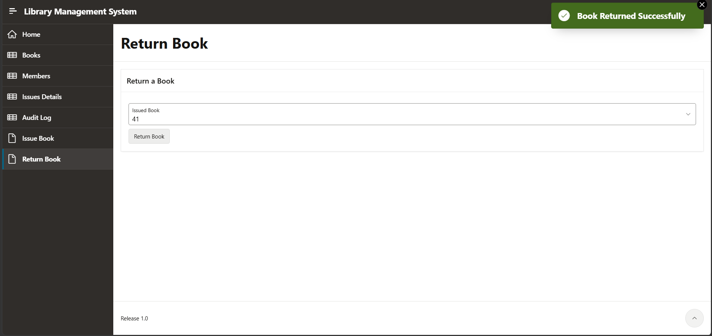
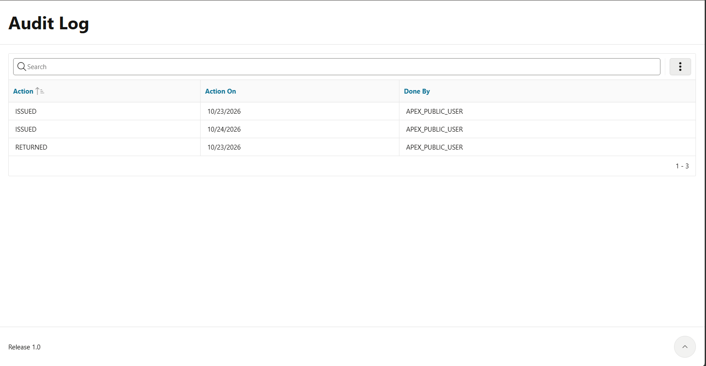
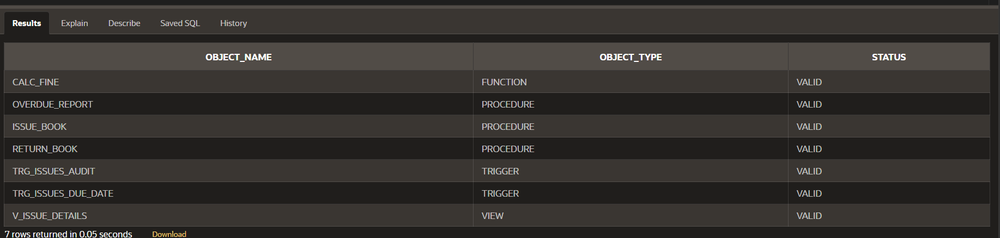

# Library Management System (PL/SQL + Oracle APEX)

A mini project in which the rules of a small library are written in **PL/SQL** and stored inside the Oracle database, with a web application built in **Oracle APEX** on top of them.

A librarian can issue and return books from the browser. The database itself checks the stock, limits each member to three books, calculates fines for late returns and writes an audit trail, so the rules hold no matter how the data is changed.

## Features

- Issue a book to a member, with checks for stock, a valid member and a limit of **3 active books per member**
- 14-day loan period, set automatically
- Return a book and calculate the fine automatically (**Rs 5 per late day**)
- Stock (`available_copies`) updated automatically on every issue and return
- Automatic audit log of every `ISSUED` and `RETURNED` action (trigger)
- Overdue report using an explicit cursor
- Clear error messages from user-defined exceptions
- Browser-based app: Books, Members, Issues Details, Audit Log, Issue Book and Return Book pages

## Tech stack

| Tool | Use |
|---|---|
| Oracle APEX | Web application (App Builder, SQL Workshop) |
| Oracle Database | Tables and stored PL/SQL |
| SQL / PL/SQL | Schema, function, procedures, triggers, cursor, exceptions |

## Repository contents

```
.
├── library_management.sql     # Full script: tables, sample data, PL/SQL, view
├── reset_data.sql             # Clears all issues and restores stock (keeps books and members)
├── apex-app/
│   └── library_management_app.sql   # Exported Oracle APEX application (import after the database script)
├── docs/
│   └── Library_Management_System_Project_Report.docx / .pdf
├── screenshots/               # Application and output screenshots
└── README.md
```

## Database design


| Table | Purpose |
|---|---|
| `BOOKS` | Book details and stock (`total_copies`, `available_copies`) |
| `MEMBERS` | Library members |
| `ISSUES` | One row per issue: book, member, issue date, due date, return date, fine |
| `ISSUE_AUDIT` | Log of every issue and return, filled by a trigger |

## PL/SQL objects

| Object | Type | What it does |
|---|---|---|
| `calc_fine` | Function | Returns the fine for an issue (Rs 5 per late day) |
| `issue_book` | Procedure | Validates the request, inserts the issue and reduces the stock |
| `return_book` | Procedure | Records the return, saves the fine and restores the stock |
| `overdue_report` | Procedure | Prints overdue books using an explicit cursor and `DBMS_OUTPUT` |
| `trg_issues_due_date` | Trigger | Sets the due date to 14 days after the issue date if none is given |
| `trg_issues_audit` | Trigger | Writes `ISSUED` / `RETURNED` entries to `ISSUE_AUDIT` |
| `v_issue_details` | View | Joins issues, books and members and derives status (`Issued`, `Returned`, `Overdue`) and fine |

**PL/SQL concepts used:** stored function and procedures, `%TYPE`, constants, `IF / ELSIF`, explicit cursor with `FOR` loop, user-defined and predefined exceptions, `RAISE_APPLICATION_ERROR`, row-level triggers (`:NEW`, `:OLD`, `INSERTING`, `UPDATING`), `COMMIT` / `ROLLBACK`, `SELECT ... FOR UPDATE`, `DBMS_OUTPUT`.

### Error messages

| Code | Message |
|---|---|
| `ORA-20001` | Book not found. |
| `ORA-20002` | No copies available for this book. |
| `ORA-20003` | Member already has 3 books issued. |
| `ORA-20004` | Member not found. |
| `ORA-20005` | This book is already returned. |
| `ORA-20006` | Issue record not found. |

## Getting started

### 1. Get an APEX workspace

Create a free workspace at [apex.oracle.com](https://apex.oracle.com) and log in.

### 2. Create the database objects

1. Open **SQL Workshop → SQL Scripts → Create**.
2. Name it `library_management`, paste the contents of `library_management.sql`, and click **Save**.
3. Click the **Run** icon, then **Run Now**.
4. Check in **SQL Workshop → Object Browser** that the four tables, the function, the procedures, the triggers and the view exist.

> Run the script **once**. The sample `INSERT` statements add the four books again if you run it a second time. To start fresh, use `reset_data.sql` instead.

### 3. Import the ready-made application (quickest)

The `apex-app/library_management_app.sql` file is a standard export of the finished application (Application ID 201095). Import it **after** running `library_management.sql`, because its pages use the tables, view and procedures from that script.

1. Open **App Builder → Import**.
2. Choose `apex-app/library_management_app.sql` and click **Next**.
3. Click **Install Application**.
4. When asked for the **Parsing Schema**, pick the schema where you ran `library_management.sql`.
5. If Application ID 201095 is already used in your workspace, choose **Auto Assign New Application ID**.
6. Click **Install Application** again, then **Run Application**.

If you import the application, skip step 4 below and go straight to step 5.

### 4. Or build the application yourself

1. **App Builder → Create → New Application**, name it *Library Management System*.
2. Add these pages in the wizard:
   - **Books**: Interactive Report with Form on `BOOKS`
   - **Members**: Interactive Report with Form on `MEMBERS`
   - **Issues Details**: Interactive Report (no form) on the view `V_ISSUE_DETAILS`
   - **Audit Log**: Interactive Report (no form) on `ISSUE_AUDIT`
3. Create two blank pages by hand.

**Issue Book (page 20)**

| Component | Setting |
|---|---|
| Item `P20_BOOK_ID` | Select List, LOV: `SELECT title d, book_id r FROM books WHERE available_copies > 0 ORDER BY title` |
| Item `P20_MEMBER_ID` | Select List, LOV: `SELECT full_name d, member_id r FROM members ORDER BY full_name` |
| Button `ISSUE` | Action: Submit Page |
| Process (Execute Code, when button `ISSUE` is pressed) | `BEGIN issue_book(:P20_BOOK_ID, :P20_MEMBER_ID); END;` |

**Return Book (page 30)**

| Component | Setting |
|---|---|
| Item `P30_ISSUE_ID` | Select List, LOV: `SELECT title \|\| ' - ' \|\| member_name d, issue_id r FROM v_issue_details WHERE status <> 'Returned' ORDER BY issue_id` |
| Button `RETURN` | Action: Submit Page |
| Process (Execute Code, when button `RETURN` is pressed) | `BEGIN return_book(:P30_ISSUE_ID); END;` |

### 5. Try it

Use **Issue Book** and **Return Book** in the app, then check **Books**, **Issues Details** and **Audit Log**.

## Running the PL/SQL directly

In **SQL Workshop → SQL Commands**, run each statement on its own:

```sql
-- all PL/SQL objects should be VALID
SELECT object_name, object_type, status
  FROM user_objects
 WHERE object_type IN ('PROCEDURE','FUNCTION','TRIGGER','VIEW');

-- issue a book (book 1 to member 1)
BEGIN issue_book(1, 1); END;

SELECT * FROM v_issue_details;

-- make the book 5 days overdue, then run the cursor report
UPDATE issues SET due_date = SYSDATE - 5 WHERE return_date IS NULL;
BEGIN overdue_report; END;

-- return it (use the issue_id shown in v_issue_details); the fine is Rs 25
BEGIN return_book(1); END;

SELECT * FROM issue_audit;
```

## Screenshots

| | |
|---|---|
|  |  |
|  |  |
|  |  |

All PL/SQL objects compiled and valid:



## Future improvements

- Member login with librarian and student roles
- Email reminders for due and overdue books (`APEX_MAIL`)
- Online fine payment
- Book reservations
- Dashboard charts

## Author

**Tanisha**, MCA, Chandigarh University
